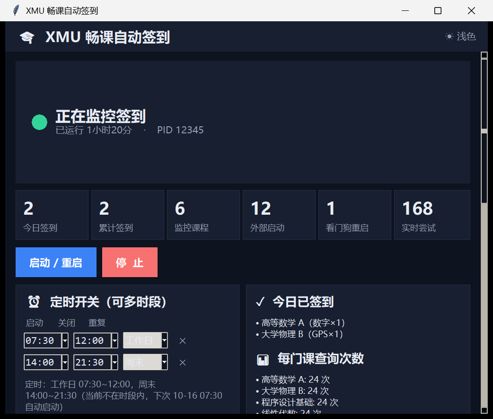
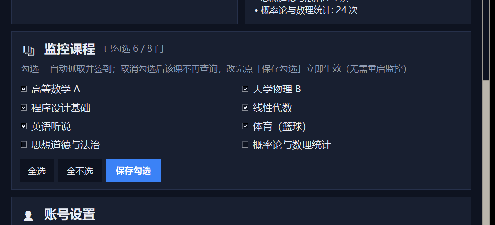

# XMU 畅课自动签到（Tronclass）

厦门大学畅课（Tronclass）自动签到工具：**纯 API 登录（无浏览器）**，支持数字签到与 GPS 签到
（两条距离探针三角定位反推坐标），带**签到门控**（等班里先签的人够了再签）、**课程勾选**、
**定时开关**，界面是自绘的 Tk 单页应用，可打包成免安装 exe。

> 基于 [ch-z-hc/XMU-AC](https://github.com/ch-z-hc/XMU-AC) 的分支，在上游基础上做了较多工程化改造：
> 打卡门控、号码双通道取码、历史点名清理、无控制台闪窗、定时任务加固、GUI 课程勾选等。
> **仅供技术学习交流，请勿用于违规用途**（见文末声明）。

---

## 功能一览

| 能力 | 说明 |
|---|---|
| 登录 | `xmulogin` CAS 纯 API 登录 + Cookie 持久化，重启免登录；强制直连（`trust_env=False`）避免失效代理劫持 |
| 数字签到 | 点名详情接口取码；2026-10 起服务端不再下发，自动改走课表日期接口 `timetable_rollcalls` 备通道 |
| GPS 签到 | 探针请求拿到两个参考距离 → 两圆求交（含误差容忍）反推坐标 → 提交 → 回查本人状态确认 |
| 签到门控 | 已签人数 **>25% 或 >20 人** 才签，避免总是第一个；拿不到名单 / 等待超 120s / 距结束 <30s 直接签 |
| 课程勾选 | 只监控自己真正在上的课，勾选存在 `course_filter.json`，改完立即生效 |
| 定时开关 | 多时段 + 每天/工作日/周末 + 跨天；任务用 XML 注册（允许电池、错过补跑） |
| 手动启停 | 打开软件**不会**自动开始签到，必须点「启动 / 重启」；点「停止」不会被自动拉起 |
| 可观测 | 界面实时显示状态/统计/事件流；子进程日志写入 `checkin.log` |
| 免安装 exe | PyInstaller 单文件打包（GUI 子系统，不弹黑窗） |

界面示意（文档截图由 `tools/demo_ui.py` 用假数据生成，不含任何个人信息）：





---

## 快速开始

### 方式一：直接用打包好的 exe

1. 下载/构建 `XMU畅课签到.exe`（见下文「打包」）；
2. 双击运行 → 在「账号设置」里填学号密码 → 保存；
3. 点「**启动 / 重启**」开始监控（**不会自动开始**，这是刻意设计）；
4. 想让它每天定时开：在「定时开关」里加时段 → 「保存并注册」。

### 方式二：源码运行

```powershell
pip install -r requirements.txt

# 首次会提示输入学号密码，之后写入 creds.env 自动登录
python auto_checkin.py
```

也可以先复制 `creds.env.example` 为 `creds.env` 填好账号，或用环境变量：

```powershell
$env:STUDENT_ID = "学号"; $env:PASSWORD = "密码"; python auto_checkin.py
```

想用图形界面（推荐）：

```powershell
python app.py
```

---

## 目录结构

```
app.py                 图形界面（Tk 单页）：状态/统计/启停/定时/课程勾选/账号/事件面板
control_panel.py       控制层：进程探测(纯 ctypes)、启停、定时任务、课程勾选、状态读取
auto_checkin.py        签到核心：登录、课程/点名轮询、门控、数字码、GPS 三角定位、看门狗
launcher_worker.py     读取 creds.env 后以 __main__ 运行 auto_checkin（给 .bat 用）
xmu_watchdog.bat       进程看门狗（崩溃 15 秒拉起，可选）
XMU畅课签到.spec        PyInstaller 打包配置（路径可移植）
tests/test_gate.py     离线单测：门控/计数/状态判定/历史点名/诊断文件（47 项）
tests/test_schedule.py 离线单测：课程勾选/时段判定/任务 XML（56 项）
tests/probe_ui.py      界面冒烟：真建窗口跑渲染路径 + 自动拉起策略断言
tests/verify_gate_live.py 联网只读校验：用真实名单回验门控读数与阈值
tools/demo_ui.py       生成文档截图（假数据，不联网、不读个人配置）
docs/教学.md            教学文档：原理、接口口径、门控设计、排障、二次开发
```

---

## 离线测试

```powershell
python tests/test_gate.py        # 47 项：门控边界、名单计数、状态判定、历史点名跳过、诊断去重
python tests/test_schedule.py    # 56 项：课程勾选、每天/工作日/周末、跨天、下次切换、任务 XML
python tests/probe_ui.py         # 界面冒烟（会闪现一个窗口）
python tests/verify_gate_live.py # 联网只读：拉真实名单回验门控（不会提交任何签到）
```

---

## 打包成 exe

```powershell
pip install pyinstaller
python -m PyInstaller --noconfirm XMU畅课签到.spec
# 产物：dist\XMU畅课签到.exe（单文件、GUI 子系统）
```

打包后的数据文件（`creds.env` / `schedule.json` / `course_filter.json` 等）都放在 **exe 同目录**。

---

## 常见问题

**Q：界面里「未运行」是我没启动吗？**
是。软件打开后不会自动开始签到，点「启动 / 重启」才开始。想让它自动开就配定时。

**Q：为什么有时等一会儿才签？**
门控在等班里先签的人超过 1/4（或 20 人）。等不到就按保底签：拿不到名单、等待超 120 秒、
距点名结束不足 30 秒。

**Q：提示「签到码暂未获取」？**
数字码在 2026-10 之后服务端不再通过点名详情下发，工具会走课表日期接口兜底；两路都拿不到
就没法提交（QR 签到同样无法自动化，token 是服务端密钥）。这类点名会被记进
`code_missing_diag.json` 方便排查。

**Q：会不会把昨天的点名一直重试刷屏？**
不会。课程列表接口会长期保留历史点名（`is_expired` 仍是 false、本人 `status` 仍是 absent），
工具按点名级状态（`rollcall_status` / 详情 `status`）+ 号码 6 小时未下发的兜底跳过，
并把重复事件压缩成「（第 N 次）」。

**Q：为什么刷新时不再有黑框一闪一闪？**
刷新循环里**不启动任何子进程**：进程探测改用 `ctypes`（`CreateToolhelp32Snapshot` + 读 PEB 命令行），
`os.system("chcp"/"cls")` 要么改成隐藏控制台子进程要么直接跳过。详见 `docs/教学.md`。

**Q：我自己停掉了，为什么它又自己起来了？**
只有「点过启动 + 当前在定时时段内」才会自动拉起；点过「停止」就保持停止。若想彻底不自动，
把定时时段取消即可。

---

## 原理与教学

完整的原理讲解、接口口径备忘、门控设计思路、排障手册、二次开发指引见
**[docs/教学.md](docs/教学.md)**。

---

## 安全与合规

- `creds.env`（学号密码明文）、`auto_checkin_session.json`（Cookie）**已被 .gitignore 忽略**，
  千万不要提交；提交前用 `git status` 复查。
- 工具只在你自己的机器上代表你自己的账号操作，请遵守学校规定；因使用产生的一切后果自负。

## 致谢 / License

- 上游：[ch-z-hc/XMU-AC](https://github.com/ch-z-hc/XMU-AC)
- 登录库：[xmulogin](https://pypi.org/project/xmulogin/)
- 本项目以 MIT 协议开源，见 [LICENSE](LICENSE)。

> 本项目仅供技术交流与学习，请勿用于非法用途。
